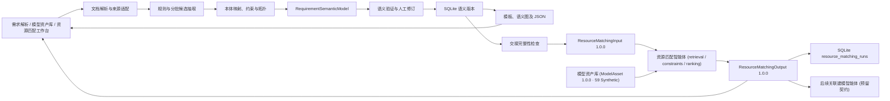

# Assessment 架构

Assessment 是独立的制造需求解析实验工作台。浏览器使用 React 18、TypeScript、Ant Design 6 和 Vite，App 持有会话、运行、模板及版本选择状态。FastAPI 编排文件解析、同一套 OpenAI 兼容 Provider 服务、SQLite 与本地原始文件。开发前调查和回归基线见 [PROJECT_AUDIT.md](PROJECT_AUDIT.md)。

## 数据与调用

1. 上传服务把原始文件保存到 `uploads/<session_id>/`，并缓存解析预览和完整文本。文件重解析复用同一个入口。
2. 领域运行读取选中文件及用户消息。表格的已识别列生成确定性事实。混合或自然语言输入再通过现有 Provider 生成候选 JSON。
3. 候选结构通过逐字段解析，证据按文档 ID、片段和原文核对。词表映射和约束、关系校验完成后创建语义快照。
4. 会话消息、版本和当前展示投影在同一事务中保存。请求开始时记录会话更新时间。若其他请求已更新会话，本次运行仍保存在历史里，当前指针由先提交的更新控制。等待 Provider 时数据库不持有写事务。
5. 模板从当前或选中的历史版本生成独立投影。模板切换、下载和来源重新核验均为无模型操作。
6. 按会话和语义版本请求交接结果时，`handoff.py` 调用 `validation.py` 的交接规则，并投影模型内的工序、约束、物料和拓扑。预览与下载共享同一实现。来源快照继续作为唯一的持久化需求事实。

## 持久化与兼容

## 多智能体分层与持久化兼容

- **智能体独立架构（`backend/agents/`）**：建立 `AgentRoleRegistry`（`registry.py`）、强角色校验配置解析器（`config.py`）、统一 OpenAI 兼容 JSON 客户端（`llm_client.py`）与标准化运行审计元数据/调用预算（`runtime.py`）。系统明确区分 `requirement_parsing`（需求解析）与 `resource_matching`（资源匹配）两类角色，独立管理 LLM 接口、密钥、模型、温度、预算、超时、Prompt、业务规则与专属工具，后端强制校验角色一致性，禁止跨角色混用或隐式回退。
- **需求解析智能体（`backend/requirement_parsing/`）**：封装经验证的文档解析、确定性抽取、LLM 分批补充、本体映射与工艺拓扑管线，统一输出 `RequirementSemanticModel` 2.2.0 与 `ResourceMatchingInput` 1.0.0，并在调试信息中记录无敏感信息的 `agent_metadata`。
- **资源匹配智能体（`backend/resource_matching/`）**：独立维护 `prompts/` 模板（v2.0.0），支持纯确定性模式（`llm_mode=disabled`）与 LLM 协同增强模式（`llm_mode=enhanced`）。在增强模式下，LLM 针对未匹配、待确认、设备文本歧义、定性约束和多能力拆分工序提出检索策略与软约束判定，但所有建议必须经过 `verify_llm_strategy_proposal` 确定性门禁（拦截幻觉资产 ID，强制复验三值硬约束，绝不绕过 FAIL/UNKNOWN），同时生成不修改上游需求的结构化诊断反馈（`feedback_items`）。
- **SQLite 兼容迁移**：启动时自动执行 `create_all` 与幂等 `ensure_schema_migrations`（自动为历史 `agent_profiles` 补建 `agent_type` 列默认回填为 `requirement_parsing`，为 `resource_matching_runs` 补建智能体角色与模式审计列，并自动初始化 `resource_matching` 默认配置），不破坏任何历史会话、消息、版本或上传文件。
- **共享资源解耦**：`domain_semantics/`（本体与词表）与 `model_assets/`（59 个 synthetic 模型资产）作为跨智能体共享知识与资产层，不绑定特定智能体或 LLM，便于后续扩展关联建模智能体及迁移至 Metatwin 平台。详述见 [资源匹配开发报告](RESOURCE_MATCHING_REPORT.md)。
- 新运行将规范语义快照保存在版本表，并在现有会话 JSON 中附上展示投影，以兼容旧模板。旧结果继续支持自定义抽取 Schema、原 JSON 编辑及旧版 Mock。可显式转换为新版本。
- 会话列表和来源校验读取 SQLite。删除原始文件后，既有版本保留当时的引用和状态，重新核验会报告来源不可用。
- 会话分支记录父版本。定向修订只替换指定工序及参数的未人工确认约束。人工审核可确认任务范围及已有目标产品。重跑语义消息使用原父版本和来源集合。
- 停止按钮同时发出显式服务端取消和浏览器中断。当前取消状态由单进程后端持有。
- Debug 保存实际阶段、耗时、请求预算、响应模型和 Provider 返回的用量。无模型请求的用量为空。可配置请求超时和预算，格式回退、结构修复、候选消歧共享预算。

## v2 运行与审核

关系端点使用 RDF 运行时契约，执行流程保留有界来源批次、结构化拓扑与人工审核版本。历史快照缺少图时，服务器即时投影。实时进度通过带运行令牌的短轮询读取，已有取消接口继续生效。相关说明见 [v2 运行机制](REFACTOR_V2.md) 和 [交接开发报告](HANDOFF_REPORT.md)。
