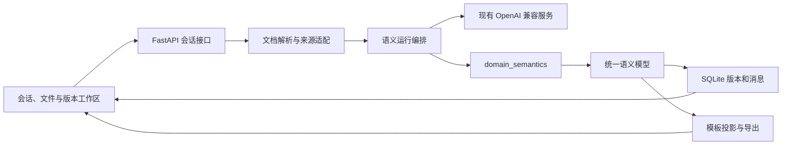

# Assessment 架构

Assessment 是独立的制造需求解析实验工作台。浏览器使用 React 18、TypeScript、Ant Design 6 和 Vite，App 持有会话、运行、模板及版本选择状态。FastAPI 编排文件解析、同一套 OpenAI 兼容 Provider 服务、SQLite 与本地原始文件。开发前调查和回归基线见 [PROJECT_AUDIT.md](PROJECT_AUDIT.md)。

## 数据与调用

1. 上传服务把原始文件保存到 `uploads/<session_id>/`，并缓存解析预览和完整文本。文件重解析复用同一个入口。
2. 领域运行读取选中文件及用户消息。表格的已识别列生成确定性事实。混合或自然语言输入再通过现有 Provider 生成候选 JSON。
3. 候选结构通过逐字段解析，证据按文档 ID、片段和原文核对。词表映射和约束、关系校验完成后创建语义快照。
4. 会话消息、版本和当前展示投影在同一事务中保存。请求开始时记录会话更新时间。若其他请求已更新会话，本次运行仍保存在历史里，当前指针由先提交的更新控制。等待 Provider 时数据库不持有写事务。
5. 模板从当前或选中的历史版本生成独立投影。模板切换、下载和来源重新核验均为无模型操作。

## 持久化与兼容

- 启动通过 SQLAlchemy `create_all` 添加 `semantic_versions`、`template_revisions` 和 `agent_execution_settings`。旧表结构、历史消息和上传文件无需迁移。旧模板第一次编辑前会保存原定义为 v1。
- 新运行将规范语义快照保存在版本表，并在现有会话 JSON 中附上展示投影，以兼容旧模板。旧结果继续支持自定义抽取 Schema、原 JSON 编辑及旧版 Mock。可显式转换为新版本。
- 会话列表和来源校验读取 SQLite。删除原始文件后，既有版本保留当时的引用和状态，重新核验会报告来源不可用。
- 会话分支记录父版本。定向修订只替换指定工序及参数的原约束，原版本仍可查看。重跑语义消息使用原父版本和来源集合。
- 停止按钮同时发出显式服务端取消和浏览器中断。当前取消状态由单进程后端持有。
- Debug 保存实际阶段、耗时、请求预算、响应模型和 Provider 返回的用量。无模型请求的用量为空。可配置请求超时和预算，格式回退、结构修复、候选消歧共享预算。
